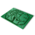

# EasySolder
EasySolder - software for manual soldering

EasySolder is a Qt desktop application that helps you hand-solder (hand-assemble) a PCB. It loads a pick-and-place file exported from Altium Designer, plus photos/scans of the top and bottom of the board, then shows where each part goes. It walks you through the parts group by group (all parts with the same value at once) and tracks which ones are done.



## Features
- **Pick-and-place import**: reads an Altium pick-and-place file in CSV format (`*.csv`). The format list in the import dialog has one entry, `CSV Altium`. Quoted fields with commas are handled.
- **Column mapping**: in the import dialog you choose which CSV column holds each of these fields: **Part** (designator), **Position X**, **Position Y**, **Layer**, **Value**, **Description** and **Code** (order number). You also give the strings that mean *Top* and *Bottom* in the layer column.
- **Data offset**: you mark the first real data row in the preview, so header and title lines are skipped (stored as `DataOffset`).
- **Top and bottom board images**: you load one image for each side. You can show the TOP layer, the BOTTOM layer, or both.
- **Image alignment (reference points)**: right-click the board image and choose *use as RefPoint1* / *use as RefPoint2*. Each side needs two reference points so the app can work out the scale and offset from CSV coordinates to image pixels. Until they are set, the image shows a `REF1`/`REF2` hint.
- **Part highlighting**: every part in the current group gets a marker on the board image. You can set the marker color (Red/Magenta/Cyan/Green/Blue/Yellow), the marker size, an optional circle around the marker ("Marker around", 0 = off), and the value text size (Small … Big 3).
- **Guided soldering workflow**: parts are grouped by value. **Start/Next** (`Enter`) marks the current group as done and moves to the next group. **UnDo** (`Backspace`) goes back. **Reset** clears all done flags. The panel shows the current value, order number, list of designators and piece count.
- **Progress**: a progress bar and a done/total count for each layer.
- **Part list**: a table with Part / Value / Layer columns. You can sort it **by NAME** or **by VALUE**, filter it by layer, and turn on *Hide when done*. Double-click a row to jump to that part.
- **Find**: a text search box with *find(next)*.
- **Zoom & pan**: zoom with the mouse wheel and pan by dragging with the middle mouse button.
- **Project files (`.esprj`)**: save and load the file paths, column mapping, data offset and reference points. Done flags are *not* saved.
- **Persistent settings**: marker and display settings and the last used directory are saved in `EasySolder.ini`.

## Typical workflow
1. In Altium, export the pick-and-place file as CSV. Take a photo or scan of both sides of the bare PCB.
2. Click **Import data**. Open the CSV, then the Top and Bottom images. Map the columns, set the Top/Bottom layer strings, and mark the first data row (the data offset).
3. Right-click the image and set RefPoint1 and RefPoint2 on two known parts, for each side.
4. Click **Save project** to create an `.esprj` file. Next time, open it with **Load project**.
5. Choose the layer and press **Start**. Solder all the highlighted parts of the shown value, then press `Enter` for the next group. Press `Backspace` to undo.

## CSV import format
The default Altium pick-and-place CSV layout is:
`Designator, Footprint, Mid X, Mid Y, Ref X, Ref Y, Pad X, Pad Y, Layer, Rotation, Comment`.
The app always skips the first line. It reads every other non-empty line as a row, and you map the columns by hand in the import dialog, so other column orders also work. Rows before the data offset are ignored. Designators must be unique; on a duplicate the app asks whether to ignore it or abort. Part type is guessed from the first letter of the designator (C = capacitor, R = resistor, …).

## Project file format (`.esprj`)
A `.esprj` file is an INI file written with `QSettings`:
```ini
[Files]
DataFormat=CSV Altium
Data=/path/board.csv
TopImage=/path/top.png
BottomImage=/path/bottom.png
DataOffset=1

[Model]
PartColon=0
CodeColon=...
ValueColon=10
PosXColon=2
PosYColon=3
DescriptionColon=...
LayerColon=8
TopLayer=TopLayer
BottomLayer=BottomLayer

[General]
TopTP1_Enabled=true
TopTP1_X=...      ; image coords
TopTP1_Y=...
TopTP1_X1=...     ; original (CSV) coords
TopTP1_Y1=...
; same for TopTP2_*, BottomTP1_*, BottomTP2_*
```
The app settings file, `EasySolder.ini`, stores `LastDirectory` and these keys in `[ALL]`: `ValueFontSize`, `PointColor`, `PointSize`, `PointAround`.

## Building
The project is written for **Qt4** and built with qmake:
```sh
qmake EasySolder.pro
make            # or mingw32-make / nmake on Windows
```
The binary is written to `bin/`. Build files go to `tmp/`.
- **Qt5+**: add `QT += widgets` to `EasySolder.pro`. Some Qt4 APIs (e.g. `qSort`, `QWheelEvent::delta`) may cause deprecation warnings.
- **`version/v.h`**: the `.pro` lists `version/v.h` (version header, created by `version/vrgen.exe`), but the file is not in the repository. Create it yourself before building.
- **Windows**: `CONFIG += qaxcontainer` turns on `exceldata.cpp`, an Excel reader/writer built on `QAxObject` (ActiveX/COM). It only works on Windows and needs Excel installed. Unix builds leave it out. The import code does not use it yet.
- An Inno Setup script for a Windows installer is in `setup/setup.iss`.

## Directory layout
```
EasySolder.pro       qmake project
main.cpp             entry point
mainwindow.*         main window, soldering workflow, project load/save, settings
workarea.*           board image view: zoom/pan, markers, reference-point calibration
importdlg.*          import dialog: CSV loading, column mapping, data offset, images
customdialogs.*      helper dialogs
exceldata.*          Windows-only Excel access via QAxObject
partitem.h           PartItem / DataModel / Setup structs
resource.qrc, img/   icons and images
app.rc, easysolder.rc, *.ico   Windows resources
bin/                 prebuilt binaries (EasySolder, EasySolder.exe) and sample EasySolder.ini
setup/setup.iss      Inno Setup installer script
todo.txt             planned features
```

## Images
The repository does not include screenshots of the app. Images used by the UI are in [`img/`](img/), for example [`img/PCB.png`](img/PCB.png), [`img/icon.png`](img/icon.png), [`img/altium.png`](img/altium.png), [`img/csv.png`](img/csv.png).

## License
GNU General Public License v3 or later. Copyright (C) 2015 Dmitry Chikov. See the license headers in the source files. The repository has no separate LICENSE file.
